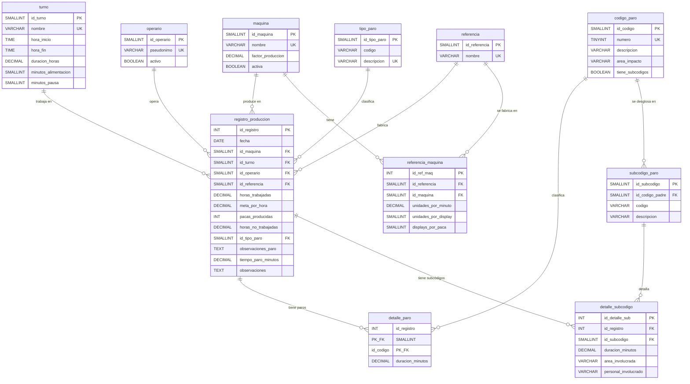

# 04 — Diseño Físico

> Motor: **MySQL 8.x** | Esquema: `paros_produccion` | Herramienta: DBeaver

---

## 1. Justificación del motor MySQL

Se eligió **MySQL** por:
- **Familiaridad**: es el motor que manejan los integrantes del equipo
- **Compatibilidad con DBeaver**: integración nativa completa
- **Soporte CHECK**: MySQL 8.0.16+ soporta restricciones CHECK funcionales
- **Rendimiento adecuado**: para ~8,000 registros históricos es más que suficiente
- **Disponibilidad**: instalación sencilla en Windows

## 2. Modelo Entidad-Relación (notación pata de gallo)

## 3. Justificación de índices

| Índice | Tabla | Columnas | Justificación |
|--------|-------|----------|---------------|
| idx_reg_fecha | registro_produccion | fecha | Todas las consultas filtran por rango de fechas |
| idx_reg_maquina_fecha | registro_produccion | id_maquina, fecha | Consulta 1: productividad por máquina y mes |
| idx_reg_turno | registro_produccion | id_turno | Consulta 4: comparación entre turnos |
| idx_dp_codigo | detalle_paro | id_codigo | Consultas 2, 7: agregación por código |
| idx_ds_subcodigo | detalle_subcodigo | id_subcodigo | Consulta 3: análisis de subcódigos |
| idx_reg_operario | registro_produccion | id_operario | Consulta 10: rendimiento por operario |

## 4. Políticas ON DELETE / ON UPDATE

| FK | ON DELETE | ON UPDATE | Justificación |
|----|----------|-----------|---------------|
| reg → maquina | RESTRICT | CASCADE | No se permite borrar una máquina con datos. Si se renombra, se propaga. |
| reg → turno | RESTRICT | CASCADE | No se permite borrar un turno con datos. |
| reg → operario | SET NULL | CASCADE | Un operario puede retirarse; sus registros se conservan sin enlace. |
| reg → referencia | SET NULL | CASCADE | Un producto puede descontinuarse; los registros se conservan. |
| reg → tipo_paro | SET NULL | CASCADE | Flexibilidad para modificar el catálogo de tipos. |
| detalle_paro → reg | CASCADE | CASCADE | Al borrar un registro, sus detalles se eliminan automáticamente. |
| detalle_paro → codigo | RESTRICT | CASCADE | No se permite borrar un código con datos. |
| detalle_sub → reg | CASCADE | CASCADE | Cascada coherente con detalle_paro. |
| detalle_sub → subcodigo | RESTRICT | CASCADE | Proteger el catálogo de subcódigos. |

