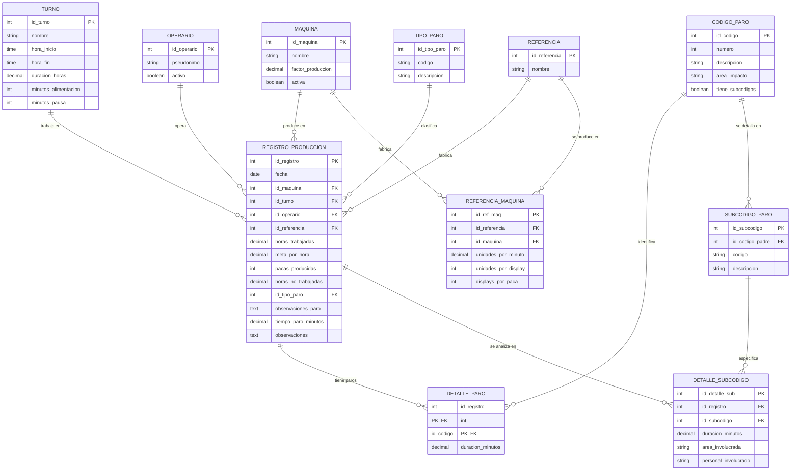

# Modelo Conceptual — Entidad-Relación

## Diagrama ER (notación pata de gallo)

## Entidades y sus relaciones

| Entidad | Tipo | Cardinalidad | Descripción |
|---------|------|-------------|-------------|
| MAQUINA → REGISTRO_PRODUCCION | 1:N | Obligatoria | Cada registro pertenece a una máquina |
| TURNO → REGISTRO_PRODUCCION | 1:N | Obligatoria | Cada registro pertenece a un turno |
| OPERARIO → REGISTRO_PRODUCCION | 1:N | Opcional | Un registro puede no tener operario asignado |
| REFERENCIA → REGISTRO_PRODUCCION | 1:N | Opcional | Un registro puede no tener referencia |
| TIPO_PARO → REGISTRO_PRODUCCION | 1:N | Opcional | Tipo de paro a nivel de turno |
| MAQUINA ↔ REFERENCIA | N:M | (vía REFERENCIA_MAQUINA) | Qué productos se fabrican en cada máquina |
| REGISTRO_PRODUCCION → DETALLE_PARO | 1:N | Opcional | Desglose de paros por código |
| CODIGO_PARO → DETALLE_PARO | 1:N | Obligatoria | Cada detalle referencia un código |
| CODIGO_PARO → SUBCODIGO_PARO | 1:N | Solo cod 01,03,05 | Subcódigos de detalle |
| REGISTRO_PRODUCCION → DETALLE_SUBCODIGO | 1:N | Opcional | Detalle de subcódigos |
| SUBCODIGO_PARO → DETALLE_SUBCODIGO | 1:N | Obligatoria | Cada detalle referencia un subcódigo |

