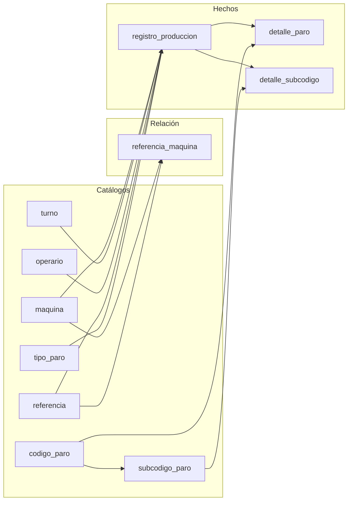

# Modelo Lógico — Esquema Relacional

## Tablas y claves

```
maquina (
    id_maquina PK,
    nombre UNIQUE NOT NULL,
    factor_produccion NOT NULL DEFAULT 1.00 CHECK(>0),
    activa NOT NULL DEFAULT TRUE
)

turno (
    id_turno PK,
    nombre UNIQUE NOT NULL,
    hora_inicio NULL,
    hora_fin NULL,
    duracion_horas NULL CHECK(>0),
    minutos_alimentacion NOT NULL DEFAULT 40,
    minutos_pausa NOT NULL DEFAULT 3
)

operario (
    id_operario PK,
    pseudonimo UNIQUE NOT NULL,
    activo NOT NULL DEFAULT TRUE
)

referencia (
    id_referencia PK,
    nombre UNIQUE NOT NULL
)

referencia_maquina (
    id_ref_maq PK,
    id_referencia FK→referencia NOT NULL,
    id_maquina FK→maquina NOT NULL,
    unidades_por_minuto NULL,
    unidades_por_display NULL,
    displays_por_paca NULL,
    UNIQUE(id_referencia, id_maquina)
)

codigo_paro (
    id_codigo PK,
    numero UNIQUE NOT NULL CHECK(1..18),
    descripcion NOT NULL,
    area_impacto NOT NULL,
    tiene_subcodigos NOT NULL DEFAULT FALSE
)

subcodigo_paro (
    id_subcodigo PK,
    id_codigo_padre FK→codigo_paro NOT NULL,
    codigo NOT NULL,
    descripcion NOT NULL,
    UNIQUE(id_codigo_padre, codigo)
)

tipo_paro (
    id_tipo_paro PK,
    codigo NULL,
    descripcion UNIQUE NOT NULL
)

registro_produccion (
    id_registro PK,
    fecha NOT NULL,
    id_maquina FK→maquina NOT NULL,
    id_turno FK→turno NOT NULL,
    id_operario FK→operario NULL,
    id_referencia FK→referencia NULL,
    horas_trabajadas NULL CHECK(>=0),
    meta_por_hora NULL CHECK(>=0),
    pacas_producidas NULL,
    horas_no_trabajadas NULL CHECK(>=0),
    id_tipo_paro FK→tipo_paro NULL,
    observaciones_paro NULL,
    tiempo_paro_minutos NULL CHECK(>=0),
    observaciones NULL
)

detalle_paro (
    id_registro FK→registro_produccion,
    id_codigo FK→codigo_paro,
    duracion_minutos NOT NULL DEFAULT 0 CHECK(>=0),
    PK(id_registro, id_codigo)
)

detalle_subcodigo (
    id_detalle_sub PK,
    id_registro FK→registro_produccion NOT NULL,
    id_subcodigo FK→subcodigo_paro NOT NULL,
    duracion_minutos NOT NULL DEFAULT 0 CHECK(>=0),
    area_involucrada NULL,
    personal_involucrado NULL
)
```

## Diagrama de dependencias (Modelo Lógico)



