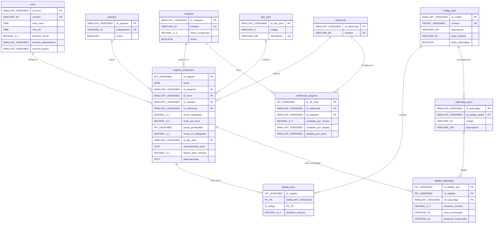

# 03 — Modelo Físico

> Motor: **MySQL 8.x** | Esquema: `paros_produccion` | Herramienta: DBeaver

---

## 1. Diagrama Entidad-Relación (notación pata de gallo)

---

## 2. Especificación de tablas

### 2.1 Tablas de catálogo (5)

#### `maquina`
Catálogo de las 4 líneas de envasado.

| Campo | Tipo | Nulo | Default | Restricciones | Descripción |
|-------|------|------|---------|---------------|-------------|
| id_maquina | SMALLINT UNSIGNED | NO | AUTO_INCREMENT | PK | Identificador único |
| nombre | VARCHAR(30) | NO | — | UNIQUE, NOT NULL | Nombre de la línea (ej. Vinilos_1) |
| factor_produccion | DECIMAL(4,2) | NO | 1.00 | CHECK(> 0) | Factor de ajuste de eficiencia |
| activa | BOOLEAN | NO | TRUE | — | Si la línea está en operación |

#### `turno`
Catálogo de turnos de trabajo.

| Campo | Tipo | Nulo | Default | Restricciones | Descripción |
|-------|------|------|---------|---------------|-------------|
| id_turno | SMALLINT UNSIGNED | NO | AUTO_INCREMENT | PK | Identificador único |
| nombre | VARCHAR(30) | NO | — | UNIQUE, NOT NULL | Nombre del turno |
| hora_inicio | TIME | SÍ | NULL | — | Hora de inicio |
| hora_fin | TIME | SÍ | NULL | — | Hora de fin |
| duracion_horas | DECIMAL(4,1) | SÍ | NULL | CHECK(> 0) | Duración en horas |
| minutos_alimentacion | SMALLINT UNSIGNED | NO | 40 | — | Minutos de alimentación/aseo |
| minutos_pausa | SMALLINT UNSIGNED | NO | 3 | — | Minutos de pausa activa |

#### `operario`
Personal de producción (pseudonimizado).

| Campo | Tipo | Nulo | Default | Restricciones | Descripción |
|-------|------|------|---------|---------------|-------------|
| id_operario | SMALLINT UNSIGNED | NO | AUTO_INCREMENT | PK | Identificador único |
| pseudonimo | VARCHAR(10) | NO | — | UNIQUE, NOT NULL | Identificador anónimo (ej. OP-001) |
| activo | BOOLEAN | NO | TRUE | — | Si está activo |

#### `referencia`
Catálogo de productos (referencias de vinilos y témperas).

| Campo | Tipo | Nulo | Default | Restricciones | Descripción |
|-------|------|------|---------|---------------|-------------|
| id_referencia | SMALLINT UNSIGNED | NO | AUTO_INCREMENT | PK | Identificador único |
| nombre | VARCHAR(80) | NO | — | UNIQUE, NOT NULL | Nombre del producto |

#### `codigo_paro`
Catálogo de los 18 códigos de paro estandarizados.

| Campo | Tipo | Nulo | Default | Restricciones | Descripción |
|-------|------|------|---------|---------------|-------------|
| id_codigo | SMALLINT UNSIGNED | NO | AUTO_INCREMENT | PK | Identificador único |
| numero | TINYINT UNSIGNED | NO | — | UNIQUE, CHECK(BETWEEN 1 AND 18) | Número del código |
| descripcion | VARCHAR(100) | NO | — | NOT NULL | Descripción del paro |
| area_impacto | VARCHAR(40) | NO | — | NOT NULL | Área responsable |
| tiene_subcodigos | BOOLEAN | NO | FALSE | — | Si tiene subcódigos |

### 2.2 Tablas de relación y clasificación (3)

#### `referencia_maquina`
Métricas de producción por combinación producto-máquina.

| Campo | Tipo | Nulo | Default | Restricciones | Descripción |
|-------|------|------|---------|---------------|-------------|
| id_ref_maq | INT UNSIGNED | NO | AUTO_INCREMENT | PK | Identificador único |
| id_referencia | SMALLINT UNSIGNED | NO | — | FK → referencia | Producto |
| id_maquina | SMALLINT UNSIGNED | NO | — | FK → maquina | Línea de envasado |
| unidades_por_minuto | DECIMAL(8,2) | SÍ | NULL | — | Velocidad de producción |
| unidades_por_display | SMALLINT UNSIGNED | SÍ | NULL | — | Unidades por display |
| displays_por_paca | SMALLINT UNSIGNED | SÍ | NULL | — | Displays por paca |

- **UNIQUE(id_referencia, id_maquina)**: Una referencia se registra una sola vez por máquina.

#### `subcodigo_paro`
Subcódigos que detallan los códigos 01, 03 y 05.

| Campo | Tipo | Nulo | Default | Restricciones | Descripción |
|-------|------|------|---------|---------------|-------------|
| id_subcodigo | SMALLINT UNSIGNED | NO | AUTO_INCREMENT | PK | Identificador único |
| id_codigo_padre | SMALLINT UNSIGNED | NO | — | FK → codigo_paro | Código padre |
| codigo | VARCHAR(10) | NO | — | NOT NULL | Código alfanumérico (ej. 1.2.C) |
| descripcion | VARCHAR(100) | NO | — | NOT NULL | Descripción del subcódigo |

- **UNIQUE(id_codigo_padre, codigo)**: No duplicar subcódigos dentro del mismo padre.

#### `tipo_paro`
Catálogo de tipos de paro descriptivos a nivel de turno/día.

| Campo | Tipo | Nulo | Default | Restricciones | Descripción |
|-------|------|------|---------|---------------|-------------|
| id_tipo_paro | SMALLINT UNSIGNED | NO | AUTO_INCREMENT | PK | Identificador único |
| codigo | VARCHAR(5) | SÍ | NULL | — | Código numérico si existe |
| descripcion | VARCHAR(100) | NO | — | UNIQUE, NOT NULL | Descripción del tipo de paro |

### 2.3 Tabla de hechos (1)

#### `registro_produccion`
Registro diario de producción. Tabla central del modelo.

| Campo | Tipo | Nulo | Default | Restricciones | Descripción |
|-------|------|------|---------|---------------|-------------|
| id_registro | INT UNSIGNED | NO | AUTO_INCREMENT | PK | Identificador único |
| fecha | DATE | NO | — | NOT NULL | Fecha del registro |
| id_maquina | SMALLINT UNSIGNED | NO | — | FK → maquina | Línea de envasado |
| id_turno | SMALLINT UNSIGNED | NO | — | FK → turno | Turno de trabajo |
| id_operario | SMALLINT UNSIGNED | SÍ | NULL | FK → operario | Operario (NULL = no registrado) |
| id_referencia | SMALLINT UNSIGNED | SÍ | NULL | FK → referencia | Producto fabricado |
| horas_trabajadas | DECIMAL(4,1) | SÍ | NULL | CHECK(>= 0) | Horas efectivas de trabajo |
| meta_por_hora | DECIMAL(8,2) | SÍ | NULL | CHECK(>= 0) | Pacas objetivo por hora |
| pacas_producidas | INT UNSIGNED | SÍ | NULL | — | Unidades producidas (pacas) |
| horas_no_trabajadas | DECIMAL(4,1) | SÍ | NULL | CHECK(>= 0) | Horas sin actividad |
| id_tipo_paro | SMALLINT UNSIGNED | SÍ | NULL | FK → tipo_paro | Clasificación del paro |
| observaciones_paro | TEXT | SÍ | NULL | — | Descripción del paro |
| tiempo_paro_minutos | DECIMAL(8,2) | SÍ | NULL | CHECK(>= 0) | Tiempo total de paro en minutos |
| observaciones | TEXT | SÍ | NULL | — | Observaciones generales |

### 2.4 Tablas de detalle (2)

#### `detalle_paro`
Desglose de duración por código de paro dentro de cada registro.

| Campo | Tipo | Nulo | Default | Restricciones | Descripción |
|-------|------|------|---------|---------------|-------------|
| id_registro | INT UNSIGNED | NO | — | PK compuesta, FK → registro_produccion | Registro padre |
| id_codigo | SMALLINT UNSIGNED | NO | — | PK compuesta, FK → codigo_paro | Código de paro |
| duracion_minutos | DECIMAL(8,2) | NO | 0 | CHECK(>= 0) | Duración del paro en minutos |

#### `detalle_subcodigo`
Desglose de subcódigos para los códigos 01, 03 y 05.

| Campo | Tipo | Nulo | Default | Restricciones | Descripción |
|-------|------|------|---------|---------------|-------------|
| id_detalle_sub | INT UNSIGNED | NO | AUTO_INCREMENT | PK | Identificador único |
| id_registro | INT UNSIGNED | NO | — | FK → registro_produccion | Registro padre |
| id_subcodigo | SMALLINT UNSIGNED | NO | — | FK → subcodigo_paro | Subcódigo de paro |
| duracion_minutos | DECIMAL(8,2) | NO | 0 | CHECK(>= 0) | Duración en minutos |
| area_involucrada | VARCHAR(30) | SÍ | NULL | — | Área (Operarios/Mantenimiento) |
| personal_involucrado | VARCHAR(10) | SÍ | NULL | — | Pseudónimo del personal |

---

## 3. Políticas de integridad referencial

| Relación (FK) | ON DELETE | ON UPDATE | Justificación |
|---------------|----------|-----------|---------------|
| registro → maquina | RESTRICT | CASCADE | No se permite borrar una máquina con registros históricos. Si se renombra, el cambio se propaga. |
| registro → turno | RESTRICT | CASCADE | No se permite borrar un turno con datos asociados. |
| registro → operario | SET NULL | CASCADE | Un operario puede retirarse de la empresa; sus registros históricos se conservan con id_operario = NULL. |
| registro → referencia | SET NULL | CASCADE | Un producto puede descontinuarse; los registros históricos se conservan. |
| registro → tipo_paro | SET NULL | CASCADE | Permite modificar el catálogo de tipos sin perder registros. |
| detalle_paro → registro | CASCADE | CASCADE | Al borrar un registro de producción, se borran automáticamente sus detalles de paro. |
| detalle_paro → codigo_paro | RESTRICT | CASCADE | No se permite borrar un código que tiene datos asociados. |
| detalle_sub → registro | CASCADE | CASCADE | Cascada coherente con detalle_paro. |
| detalle_sub → subcodigo | RESTRICT | CASCADE | Proteger el catálogo de subcódigos mientras tenga datos. |
| referencia_maquina → referencia | RESTRICT | CASCADE | No borrar referencia con métricas asociadas. |
| referencia_maquina → maquina | RESTRICT | CASCADE | No borrar máquina con métricas asociadas. |
| subcodigo → codigo_paro | RESTRICT | CASCADE | El código padre debe existir mientras tenga subcódigos. |

---

## 4. Índices

| Índice | Tabla | Columnas | Tipo | Justificación |
|--------|-------|----------|------|---------------|
| idx_reg_fecha | registro_produccion | fecha | BTREE | Todas las consultas de indicadores filtran por rango de fechas. EXPLAIN muestra uso en WHERE fecha BETWEEN. |
| idx_reg_maquina_fecha | registro_produccion | (id_maquina, fecha) | BTREE compuesto | Consulta 1 (productividad por máquina y mes). El índice compuesto cubre tanto el filtro como el agrupamiento. |
| idx_reg_turno | registro_produccion | id_turno | BTREE | Consulta 4 (comparación entre turnos). Acelera el JOIN y GROUP BY. |
| idx_dp_codigo | detalle_paro | id_codigo | BTREE | Consultas 2 y 7 (participación por código, top 10 causas). Acelera el agrupamiento por código. |
| idx_ds_subcodigo | detalle_subcodigo | id_subcodigo | BTREE | Consulta 3 (análisis detallado de subcódigos 01, 03, 05). Acelera el JOIN con subcodigo_paro. |
| idx_reg_operario | registro_produccion | id_operario | BTREE | Consulta 10 (operarios con registros sin producción). Acelera el filtro por operario. |

**Nota sobre EXPLAIN**: La verificación con `EXPLAIN` requiere una instancia MySQL activa. Se demostrará durante la sustentación ejecutando las consultas con `EXPLAIN ANALYZE` en DBeaver.

---

## 5. Resumen cuantitativo del esquema

| Elemento | Cantidad |
|----------|----------|
| Tablas | 11 |
| Columnas totales | 62 |
| Claves primarias | 11 |
| Claves foráneas | 12 |
| Restricciones UNIQUE | 8 |
| Restricciones CHECK | 8+ |
| Índices adicionales | 6 |
| Registros históricos migrados | 8,208 |
| Detalles de paro migrados | 16,532 |
| Detalles de subcódigo migrados | 1,115 |

